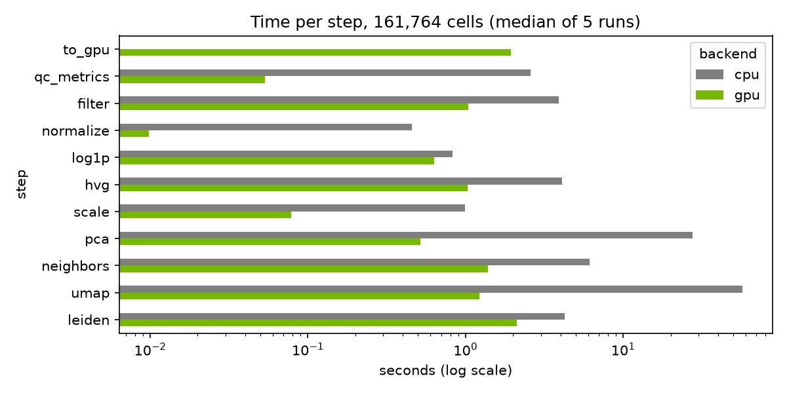
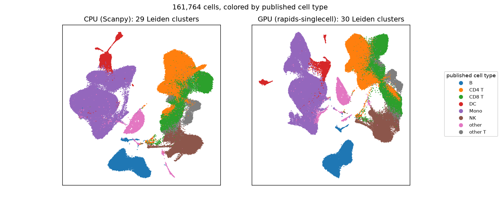

# Single-cell analysis on a laptop GPU

**What can an 8 GB laptop GPU do with rapids-singlecell?**

**Status:** benchmark done; blog post written ([`blog_post.md`](blog_post.md)).

**TL;DR** On a laptop with an RTX 5070 Laptop GPU (8 GB), a standard Scanpy workflow on 161,764 cells
took **~10 s on the GPU vs. ~109 s on a 16-thread laptop CPU (about 11x faster; 9-15x across dataset sizes,
median of 5 runs)**. The whole dataset fit in 8 GB (peak ~7 GB), and GPU clusters matched the published cell
types as well as CPU clusters did.

NVIDIA has already shown that [rapids-singlecell](https://rapids-singlecell.readthedocs.io) speeds up
single-cell RNA-seq analysis
([NVIDIA blog post](https://developer.nvidia.com/blog/gpu-accelerated-single-cell-rna-analysis-with-rapids-singlecell/)).
This repo asks the practical follow-up for students and small labs: **is a consumer laptop GPU enough?**

It runs the same workflow on a laptop's CPU ([Scanpy](https://scanpy.readthedocs.io)) and on its GPU
(rapids-singlecell) and answers three questions:

1. **Speed:** how much faster is each step on the laptop GPU vs. a 16-thread laptop CPU?
2. **Limits:** how many cells fit in 8 GB of GPU memory?
3. **Correctness:** do the CPU and GPU find the same cell populations?

It also includes **new-user notes**: what it took to get the GPU stack running on a brand-new GPU under WSL2.

## Setup

| | |
|---|---|
| GPU | NVIDIA GeForce RTX 5070 Laptop GPU, 8 GB (driver 577.05) |
| CPU | Intel Core Ultra 9 275HX, 16 threads visible to WSL2 |
| RAM | 27 GB available to WSL2 |
| OS | Windows + WSL2 (Linux) |
| Software | Python 3.12, Scanpy 1.12.6, rapids-singlecell 0.18.1, CuPy 14.2 (see `results/system.json`) |
| Dataset | NYGC multimodal PBMC, Hao et al. 2021 (*Cell*), from [CELLxGENE](https://cellxgene.cziscience.com/): 161,764 blood immune cells x 20,264 genes, raw counts |

## What is compared

| Step | CPU | GPU |
|---|---|---|
| QC metrics, filtering | `sc.pp.calculate_qc_metrics` | `rsc.pp.calculate_qc_metrics` |
| Normalize + log1p | `sc.pp.normalize_total`, `sc.pp.log1p` | `rsc.pp.normalize_total`, `rsc.pp.log1p` |
| Highly variable genes (2,000) | `sc.pp.highly_variable_genes` | `rsc.pp.highly_variable_genes` |
| Scale, PCA (50 PCs) | `sc.pp.scale`, `sc.pp.pca` | `rsc.pp.scale`, `rsc.pp.pca` |
| kNN graph (k=15), UMAP | `sc.pp.neighbors`, `sc.tl.umap` | `rsc.pp.neighbors`, `rsc.tl.umap` |
| Leiden clustering (resolution 1.0) | `sc.tl.leiden` (igraph) | `rsc.tl.leiden` (cuGraph) |

Fairness rules:
- Same cells (fixed random subsample), same parameters, same filtering code for both backends.
- A warm-up run at the smallest benchmark size (different random cells) first, so one-time compilation is not counted.
- GPU timings wait for the GPU to finish each step (`cudaDeviceSynchronize`), since GPU work is asynchronous.
- Copying data to the GPU is timed and included in the GPU total.
- Each size runs 5 times on the same cells, alternating CPU and GPU, so slow periods (heat, background load)
  hit both; tables show the median.

## Results

### 1. Speed

Median of 5 runs; min-max in parentheses.

| cells | CPU (s) | GPU (s) | speedup |
|---:|---:|---:|---:|
| 10,000 | 9.2 (9.0-9.8) | 1.1 (1.0-1.1) | 8.7x |
| 50,000 | 27.6 (26.9-27.9) | 2.4 (2.3-2.5) | 11.7x |
| 100,000 | 57.2 (55.2-63.0) | 3.9 (3.7-4.7) | 14.5x |
| 161,764 | 108.8 (104.2-137.1) | 10.1 (9.4-19.4) | 10.8x |


Where the time goes at 161,764 cells (median of 5 runs):

| step | CPU (s) | GPU (s) | speedup |
|---|---:|---:|---:|
| copy to GPU | - | 1.95 | - |
| QC metrics | 2.60 | 0.05 | 49x |
| filter | 3.90 | 1.04 | 4x |
| normalize | 0.46 | 0.01 | 47x |
| log1p | 0.83 | 0.63 | 1.3x |
| highly variable genes | 4.08 | 1.03 | 4x |
| scale | 1.00 | 0.08 | 13x |
| PCA | 27.55 | 0.52 | 53x |
| kNN graph | 6.14 | 1.38 | 4x |
| UMAP | 57.17 | 1.22 | 47x |
| Leiden | 4.27 | 2.11 | 2x |



Observations:
- **UMAP and PCA dominate on the CPU** (~78% of CPU time) and get the biggest GPU speedups (~47-53x).
- **Leiden and the copy to the GPU are now the largest GPU costs** (~2 s each of ~10 s). Loading data
  straight onto the GPU, or keeping it there across analyses, would matter more than faster kernels.
  The copy also varied most between runs (1.3-11.3 s).
- **Leiden barely benefits on a laptop**: 2x at full size, and at 10k cells it was slower on the GPU
  (0.42 s vs. 0.11 s).
- **The speedup peaks at 100k cells and drops at full size.** Going from 100k to 161k cells (1.6x more),
  several GPU steps took 5-6x longer (HVG 0.17 to 1.03 s, log1p 0.10 to 0.63 s), while peak GPU memory
  reached 7 of 8 GB. A likely cause is the GPU running close to its memory limit; this is not verified.
- The full table for every size and run is in `results/timings.csv`.

### 2. How far does 8 GB go?

| cells | GPU run | peak GPU memory |
|---:|---|---:|
| 10,000 | ok | 0.4 GB |
| 50,000 | ok | 2.2 GB |
| 100,000 | ok | 4.3 GB |
| 161,764 | ok | 7.0 GB |

The whole dataset fit. Memory grew almost linearly (~43 MB per 1,000 cells for this dataset), so
extrapolating, about 180,000 cells is the ceiling for this workflow on 8 GB. That is an estimate, not
a measurement, and it depends on how many genes are detected per cell (~2,200 here). Peak memory is sampled
after each step, so short spikes inside a step may be missed. For bigger data, `--managed-memory` lets
CUDA spill to system RAM (not yet benchmarked here).

### 3. Do the results agree?



Both UMAPs are colored by the **published** cell types (not by our clusters), so the colors are directly
comparable: the CPU and GPU separate the same populations (B cells, monocytes, NK cells, CD4/CD8 T cells, DCs).

| cells | CPU vs. GPU | CPU vs. CPU, other Leiden seed | GPU vs. GPU, other Leiden seed | CPU vs. published types | GPU vs. published types |
|---:|---:|---:|---:|---:|---:|
| 10,000 | 0.91 | 0.87 | 0.96 | 0.52 | 0.52 |
| 50,000 | 0.87 | 0.92 | 0.99 | 0.52 | 0.50 |
| 100,000 | 0.84 | 0.88 | 0.93 | 0.48 | 0.53 |
| 161,764 | 0.78 | 0.84 | 0.97 | 0.47 | 0.49 |

All values are Adjusted Rand Index (ARI): 1.0 for identical groupings, ~0 for random ones.

- **CPU and GPU clusters are not identical**, because the kNN search, UMAP and Leiden implementations differ.
- **Much of that difference is within Leiden's own randomness.** Rerunning CPU Leiden on the same graph with
  only a different seed already gives an ARI of 0.84-0.92. At 10k cells, CPU and GPU agree more than CPU
  agrees with itself; from 50k cells, CPU vs. GPU is 0.04-0.06 below the CPU seed baseline, which likely
  comes from the different kNN graphs (the seed baseline keeps the graph fixed).
- **GPU Leiden is much less seed-sensitive** (0.93-0.99), though not fully reproducible: on the same graph,
  an earlier run at full size found 28 clusters and later runs 30 (CPU vs. GPU ARI 0.80 vs. 0.78).
- **Both recover the published cell types equally well**, so the GPU does not lose biology. (The ARI against
  published types is moderate for both, because Leiden at resolution 1.0 splits cells into a different number
  of groups than the 30 annotated types.)

## New-user notes

What it took to get this running on an RTX 50-series laptop GPU under WSL2:

1. **No CUDA toolkit install was needed.** Only the normal Windows NVIDIA driver; WSL2 picks it up and the
   pip packages bring the CUDA libraries.
2. **Use Python 3.12.** The system Python (3.14) was too new for the RAPIDS packages; `uv` made a 3.12 env easy.
3. **`pip install rapids-singlecell` failed**: version 0.18.1 is published only as source code, and building
   it needs a C++/CUDA compiler. The prebuilt package worked:
   `pip install 'rapids-singlecell-cu12[rapids]' --extra-index-url=https://pypi.nvidia.com`.
   A clearer pointer to the `-cu12` package for pip users would help newcomers.
4. **CELLxGENE files ship precomputed results** (neighbors, UMAP), and `sc.pp.neighbors` crashed on the stale
   graph (`KeyError: 'n_neighbors'`). Starting from the raw counts only fixed it.
5. **RAM matters as much as GPU memory.** These files store normalized values *and* raw counts, with 64-bit
   indices; loading everything briefly needed >10 GB of RAM, and extra copies pushed WSL2 into swap, which
   made timings erratic. Reading only `raw/X` and avoiding copies fixed it.
6. **Benchmarking pitfall:** the first CPU kNN call at 10k cells took 14 s, almost all one-time compilation.
   Smaller warm-ups (2,000 and 8,000 cells) did not trigger the same code path; warming up at the benchmark size did.

## Run it yourself

```bash
# CPU-only smoke test on the PBMC 3k demo data
pip install -r requirements.txt
python benchmark.py --cpu-only --sizes 2000

# Full benchmark (needs an NVIDIA GPU + rapids-singlecell, see below)
python benchmark.py --data data/nygc_pbmc_161k.h5ad --sizes 10000,50000,100000,161764 --repeats 5
python plot_results.py
```

**GPU setup:** with Python 3.12, the prebuilt CUDA 12 package worked:

```bash
pip install 'rapids-singlecell-cu12[rapids]' --extra-index-url=https://pypi.nvidia.com
```

See also the rapids-singlecell install guide
(<https://rapids-singlecell.readthedocs.io/en/latest/Installation.html>) and the notes above.
No local GPU? A Google Colab GPU runtime works too, but note that Colab's CPU has only 2 cores,
which makes the CPU baseline look slower than on a typical workstation.

**Data:** any `.h5ad` or 10x `.h5` file with raw counts. If the file stores normalized values in `X` and
raw counts in `.raw` (common for CELLxGENE downloads), the script uses `.raw` automatically.

## Code layout

| File | What it does |
|---|---|
| `benchmark.py`, `plot_results.py` | Command-line entry points |
| `scbench/workflow.py` | The workflow, written once for both backends, with per-step timing |
| `scbench/backends.py` | CPU (Scanpy) and GPU (rapids-singlecell) backends: which library, and the few backend-specific arguments |
| `scbench/data.py` | Loads raw counts and published cell types |
| `scbench/gpu.py` | GPU memory tracking and managed-memory setup |
| `scbench/results.py` | Cluster agreement (ARI) and the CSV outputs |
| `scbench/plots.py` | UMAP comparison, timing charts and the Markdown summary |
| `scbench/cli.py` | Command-line options and the loop over dataset sizes |

## Write-up

See [`blog_post.md`](blog_post.md).
