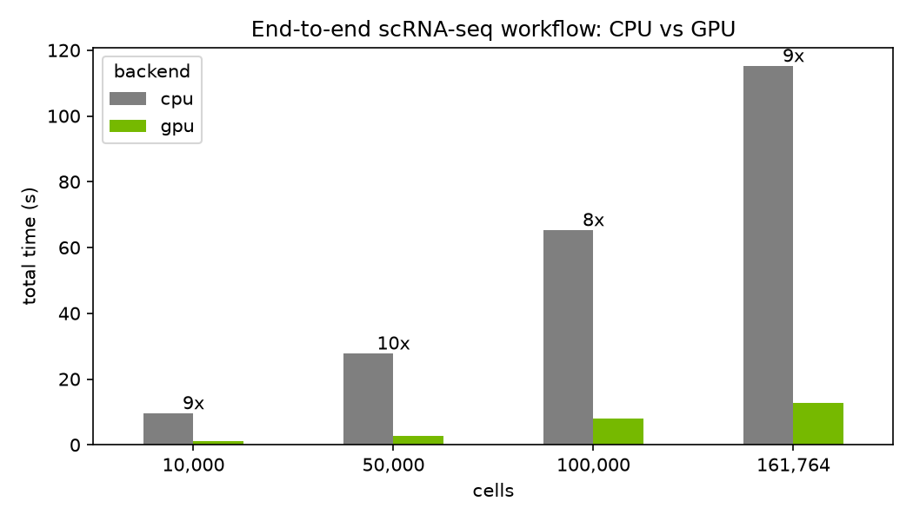
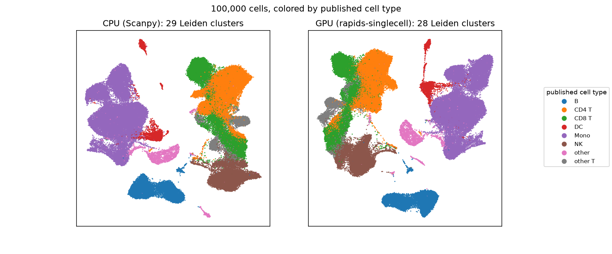

# Single-cell analysis on a laptop GPU

**What can an 8 GB laptop GPU do with rapids-singlecell?**

**Status: in progress.** Results will be added as the benchmark runs.

NVIDIA has already shown that [rapids-singlecell](https://rapids-singlecell.readthedocs.io) speeds up
single-cell RNA-seq analysis
([NVIDIA blog post](https://developer.nvidia.com/blog/gpu-accelerated-single-cell-rna-analysis-with-rapids-singlecell/)).
This repo asks the practical follow-up for students and small labs: **is a consumer laptop GPU enough?**

It runs the same workflow on a laptop's CPU ([Scanpy](https://scanpy.readthedocs.io)) and on its GPU
(rapids-singlecell) and answers three questions:

1. **Speed:** how much faster is each step on the laptop GPU vs. a 16-thread laptop CPU?
2. **Limits:** how many cells fit in 8 GB of GPU memory, which step fails first, and what helps?
3. **Correctness:** do the CPU and GPU find the same clusters?

It also includes **new-user notes**: what it took to install the GPU stack on a brand-new GPU under WSL2.

## Setup

| | |
|---|---|
| GPU | NVIDIA GeForce RTX 5070 Laptop GPU, 8 GB |
| CPU | [model], 16 threads |
| RAM | 27 GB available to WSL2 |
| OS | Windows + WSL2 (Linux) |
| Software | see `results/system.json` (Python, Scanpy, rapids-singlecell, CuPy versions) |
| Dataset | [name, link, number of cells] |

## What is compared

| Step | CPU | GPU |
|---|---|---|
| QC metrics, filtering | `sc.pp.calculate_qc_metrics` | `rsc.pp.calculate_qc_metrics` |
| Normalize + log1p | `sc.pp.normalize_total`, `sc.pp.log1p` | `rsc.pp.normalize_total`, `rsc.pp.log1p` |
| Highly variable genes (2,000) | `sc.pp.highly_variable_genes` | `rsc.pp.highly_variable_genes` |
| Scale, PCA (50 PCs) | `sc.pp.scale`, `sc.pp.pca` | `rsc.pp.scale`, `rsc.pp.pca` |
| kNN graph (k=15), UMAP | `sc.pp.neighbors`, `sc.tl.umap` | `rsc.pp.neighbors`, `rsc.tl.umap` |
| Leiden clustering | `sc.tl.leiden` (igraph) | `rsc.tl.leiden` (cuGraph) |

Fairness rules:
- Same cells (fixed random subsample), same parameters, same filtering code for both backends.
- A warm-up run on 2,000 cells first, so one-time compilation is not counted.
- GPU timings wait for the GPU to finish each step (`cudaDeviceSynchronize`), since GPU work is asynchronous.
- Copying data to the GPU is timed and included in the GPU total.

## Results

### 1. Speed

| cells | CPU (s) | GPU (s) | speedup |
|---:|---:|---:|---:|
| [ ] | [ ] | [ ] | [ ] |




### 2. How far does 8 GB go?

| cells | GPU run | peak GPU memory | first step to fail |
|---:|---|---:|---|
| [ ] | [ok / out of memory] | [ ] GB | [ ] |

What helped: [e.g. fewer highly variable genes, skipping dense scaling, ...]

### 3. Do the results agree?

Adjusted Rand Index between CPU and GPU Leiden clusters: [ ] (1.0 = identical).
Small differences are expected because the kNN search and Leiden implementations differ.



## New-user notes

[What it took to install rapids-singlecell on an RTX 50-series laptop GPU under WSL2: steps that worked,
errors hit and how they were fixed, anything the docs could make clearer.]

## Run it yourself

```bash
# CPU-only smoke test on the PBMC 3k demo data
pip install -r requirements.txt
python benchmark.py --cpu-only --sizes 2000

# Full benchmark (needs an NVIDIA GPU + rapids-singlecell, see below)
python benchmark.py --data data/<dataset>.h5ad --sizes 10000,50000,100000
python plot_results.py
```

**GPU setup:** with Python 3.12, the prebuilt CUDA 12 package worked:

```bash
pip install 'rapids-singlecell-cu12[rapids]' --extra-index-url=https://pypi.nvidia.com
```

See also the rapids-singlecell install guide
(<https://rapids-singlecell.readthedocs.io/en/latest/Installation.html>) and the notes above.
No local GPU? A Google Colab GPU runtime works too, but note that Colab's CPU has only 2 cores,
which makes the CPU baseline look slower than on a typical workstation.

**Data:** any `.h5ad` or 10x `.h5` file with raw counts. If the file stores normalized values in `X` and
raw counts in `.raw` (common for CELLxGENE downloads), the script uses `.raw` automatically.

## Write-up

See [`blog_post.md`](blog_post.md).
