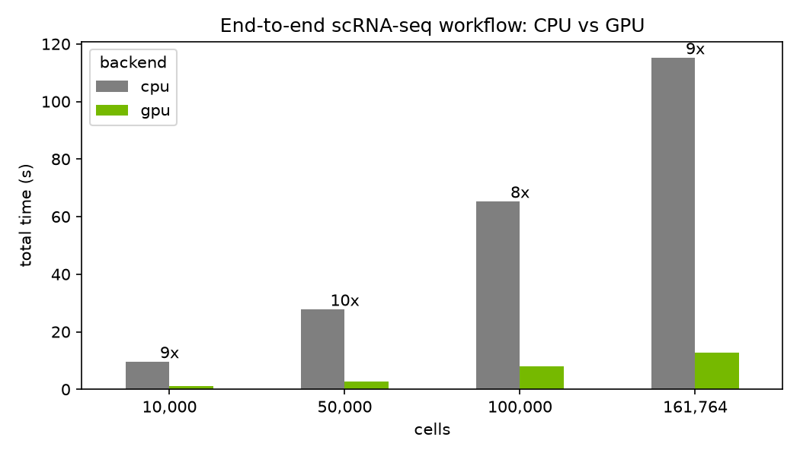
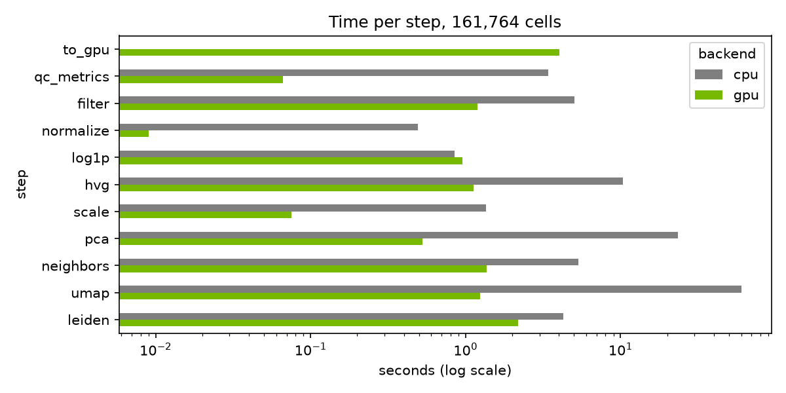
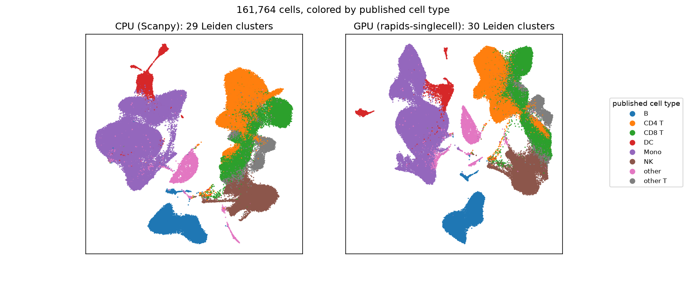

# Single-cell analysis on a laptop GPU: what an 8 GB RTX 5070 can (and can't) do with rapids-singlecell

## Is the GPU in your laptop enough?

At work I built an RNA-seq pipeline in Nextflow, and some steps, like STAR alignment, ran for hours on
CPUs. I wanted to know how much of that time a GPU could save. NVIDIA's Parabricks accelerates
alignment, including STAR, but I'm still waiting for AWS to raise my GPU instance quota. So I started
with the GPU I already had, the one in my laptop, and a different part of the RNA-seq world: single-cell
analysis, where RAPIDS already has a GPU toolkit.

NVIDIA has shown that [rapids-singlecell](https://rapids-singlecell.readthedocs.io) can speed up
single-cell RNA-seq analysis a lot
([Dicks & Nolet, NVIDIA Technical Blog, June 2023](https://developer.nvidia.com/blog/gpu-accelerated-single-cell-rna-analysis-with-rapids-singlecell/)).
On about 90,000 cells, their full notebook (excluding decoupler) ran 21x faster on an A100 80 GB server
GPU and 16x faster on a desktop RTX 3090. Those are big machines: the A100 has 80 GB of GPU memory and
the RTX 3090 has 24 GB. Many students and small labs have a laptop with an 8 GB GPU instead. So I asked
a simpler question: **is the GPU already in your laptop enough to make a difference?**

## Setup

- **Laptop:** NVIDIA GeForce RTX 5070 Laptop GPU (8 GB) vs. Intel Core Ultra 9 275HX (16 threads
  visible to WSL2), Windows + WSL2, 27 GB RAM available to Linux.
- **Data:** the NYGC multimodal PBMC dataset (Hao et al. 2021, *Cell*) from CELLxGENE: 161,764 blood
  immune cells, raw counts. I ran random subsets of 10k, 50k and 100k cells, plus the full dataset.
- **Workflow:** QC, filtering, normalization, log1p, 2,000 highly variable genes, scaling, PCA (50 PCs),
  kNN graph (k=15), UMAP and Leiden clustering. Same cells and parameters for Scanpy (CPU) and
  rapids-singlecell (GPU). Copying data to the GPU counts toward the GPU time.

NVIDIA's notebooks include extra steps (regress-out, Harmony, t-SNE, decoupler), so the end-to-end
numbers are not directly comparable. The per-step numbers are.

## Getting it running

No CUDA toolkit install was needed. The normal Windows NVIDIA driver is enough: WSL2 picks it up, and
the pip packages bring their own CUDA libraries. Three things did trip me up:

1. **Python version.** My system Python (3.14) was too new for RAPIDS. A Python 3.12 environment
   (created with `uv`) worked.
2. **The package name.** `pip install rapids-singlecell` failed, because that version is published only
   as source code and building it needs a C++/CUDA compiler. The prebuilt package installed cleanly:
   ```bash
   pip install 'rapids-singlecell-cu12[rapids]' --extra-index-url=https://pypi.nvidia.com
   ```
   A clearer pointer to the `-cu12` package for pip users would save newcomers time.
3. **The data file, not the GPU.** CELLxGENE files ship normalized values, raw counts and precomputed
   results. The stale neighbor graph crashed `sc.pp.neighbors` (`KeyError: 'n_neighbors'`), and loading
   everything pushed WSL2 into swap. Reading only the raw counts fixed both.

One benchmarking lesson: the first CPU kNN call took 14 s, almost all of it one-time compilation. Warm
up at the size you benchmark, or the CPU looks slower than it is.

## How much code changes?

Almost none. On the CPU with Scanpy:

```python
import scanpy as sc

sc.pp.normalize_total(adata)
sc.pp.log1p(adata)
sc.pp.highly_variable_genes(adata)
sc.pp.pca(adata)
sc.pp.neighbors(adata)
sc.tl.umap(adata)
sc.tl.leiden(adata)
```

On the GPU, you move the data to the GPU once, then swap `sc` for `rsc`:

```python
import rapids_singlecell as rsc

rsc.get.anndata_to_GPU(adata)
rsc.pp.normalize_total(adata)
rsc.pp.log1p(adata)
rsc.pp.highly_variable_genes(adata)
rsc.pp.pca(adata)
rsc.pp.neighbors(adata)
rsc.tl.umap(adata)
rsc.tl.leiden(adata)
```

The result is a normal AnnData object, so plotting and downstream analysis stay the same.

## Speed: 9-15x faster, from 10k cells up

Each size ran 5 times on the same cells, alternating CPU and GPU. Times are medians.

| cells | CPU (s) | GPU (s) | speedup |
|---:|---:|---:|---:|
| 10,000 | 9.2 | 1.1 | 8.7x |
| 50,000 | 27.6 | 2.4 | 11.7x |
| 100,000 | 57.2 | 3.9 | 14.5x |
| 161,764 | 108.8 | 10.1 | 10.8x |



The full dataset went from almost two minutes to about 10 seconds. The GPU already paid off at 10,000
cells, so you don't need a huge dataset to benefit. The speedup peaked at 100,000 cells and dropped at
full size; more on that in the next section.



The per-step picture explains the total:

- **UMAP and PCA** take about 78% of the CPU time and get the biggest gains: 47x and 53x. These are
  the steps you rerun most when you tune parameters, so this is where the time saved adds up.
- **QC metrics, normalization and scaling** are 13-49x faster, but they were already quick on the CPU.
- **kNN graph (4x) and Leiden (2x)** gain much less. At 10,000 cells, Leiden was slower on the GPU
  (0.42 s vs. 0.11 s).
- **Leiden and copying data to the GPU** are now the largest GPU costs, about 2 s each of the 10 s.
  If you load once and keep the data on the GPU while you explore, you pay for the copy once.

## The 8 GB wall

I expected to run out of memory, but I didn't. The full 161,764-cell dataset ran on the GPU with a peak
of 7.0 GB.

| cells | peak GPU memory |
|---:|---:|
| 10,000 | 0.4 GB |
| 50,000 | 2.2 GB |
| 100,000 | 4.3 GB |
| 161,764 | 7.0 GB |

It did slow down, though. Going from 100,000 to 161,764 cells (1.6x more), several GPU steps took 5-6x
longer, which is why the speedup dropped from 14.5x to 10.8x. My guess is that the GPU works harder
near its memory limit, but I haven't verified that.

Memory grew almost linearly, about 43 MB per 1,000 cells. Extrapolating, about 180,000 cells is the
ceiling for this workflow on 8 GB. That is an estimate, not a measurement. It also depends on how many
genes are detected per cell (about 2,200 here).


## Same biology?



Both UMAPs are colored by the published cell types, and both show the same populations: B cells,
monocytes, NK cells, CD4 and CD8 T cells, and dendritic cells.

To measure agreement I used the Adjusted Rand Index (ARI): 1.0 means two clusterings are identical, 0
means they match no better than chance. CPU and GPU clusters scored 0.78-0.80 on the full dataset (0.91
at 10k cells). They differ because each library implements the neighbor search, UMAP and Leiden
differently.

For scale: Leiden is partly random, so running it twice on the CPU with different seeds gives an ARI of
only 0.84-0.92. Most of the CPU-GPU gap is this ordinary randomness. The GPU was more consistent with
itself (0.93-0.99).

Most important, both match the published cell types equally well (ARI 0.47 CPU, 0.49-0.50 GPU). These
scores are well below 1 because the published labels are 30 fine-grained types, annotated with RNA plus
surface-protein data; RNA-only clusters can't separate all of them. The GPU gives the same biology as
the CPU.

## Takeaways

- **If you have a laptop with an 8 GB NVIDIA GPU, use it.** A standard Scanpy workflow ran 9-15x
  faster on datasets from 10,000 to about 160,000 cells, with only a few lines of code changed.

Code and full results: https://github.com/DavidGegic95/scrna-laptop-gpu-benchmark
